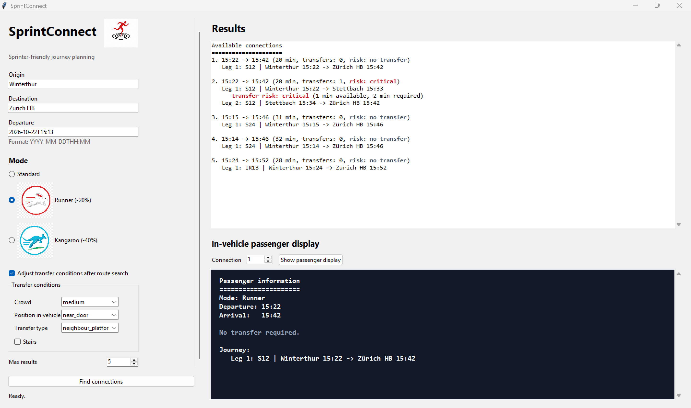

# SprintConnect

SprintConnect is a SprintConnect prototype for sprinter-friendly public transport journey planning in the ZVV / Swiss GTFS data context.

The application searches public transport connections and evaluates transfer risk for passengers who can make faster-than-standard transfers. It supports a graphical user interface, GTFS data caching, route calculation, configurable sprinter profiles, transfer-condition adjustment, and an in-vehicle passenger information display.



## Project Idea

Standard journey planners usually allow passengers to increase transfer times, but they do not support shorter transfer times for experienced passengers. SprintConnect explores this missing feature.

The prototype answers the question:

Can a passenger make this connection if they know the station, move quickly, and are willing to accept a higher transfer risk?

The application does not only calculate the fastest connection. It estimates transfer risk under realistic conditions.

## Main Features

- Query origin and destination stops
- Select departure date and time
- Choose a passenger mode:
  - `Standard`
  - `Runner (-20%)`
  - `Kangaroo (-40%)`
- Download and cache GTFS schedule data
- Process selected GTFS files:
  - `stops.txt`
  - `stop_times.txt`
  - `trips.txt`
  - `routes.txt`
  - `transfers.txt`
- Build direct and one-transfer connections
- Show colored risk labels:
  - `safe`
  - `tight`
  - `critical`
  - `no transfer`
- Adjust transfer conditions after route search:
  - crowd level
  - position in vehicle
  - transfer type
  - stairs
- Select a connection and show a separate in-vehicle passenger display

## Architecture

The code follows the class structure used in the presentation.

| Class | Responsibility |
| --- | --- |
| `DataDownloader` | Downloads GTFS ZIP data and manages the local cache |
| `DataProcessor` | Extracts and loads the required GTFS files into pandas data frames |
| `RouteBuilder` | Finds direct and one-transfer connections |
| `SprinterProfile` | Defines passenger speed profile: Standard, Runner, Kangaroo |
| `TransferContext` | Stores transfer conditions such as crowd, stairs, and vehicle position |
| `Scenario` | Combines user input into one route-search scenario |
| `RiskEvaluator` | Calculates transfer feasibility and risk labels |
| `SprinterRouteDisplay` | Formats route results for console and GUI output |
| `PassengerInformation` | Simulates the in-vehicle passenger information display |
| `SprintConnectGUI` | Provides the Tkinter graphical user interface |
| `SprintConnectApplication` | Coordinates the complete application workflow |

## Data Source

SprintConnect uses GTFS schedule data from Open Data Platform Mobility Switzerland:

https://data.opentransportdata.swiss

The application contains:

- a permalink for the current GTFS resource
- a fixed GTFS ZIP URL for reproducible project results
- a local cache in `data_cache/gtfs.zip`
- a cache age of 3 days

If the cache is still fresh, the application reuses the local ZIP file. If the cache is old, it checks the online resource and downloads a newer file when needed. If downloading fails but a cached file exists, the application can continue with the cached data.

## Requirements

- Python 3.14 or newer
- pandas
- tkinter, included with the standard Python installation on most systems

Dependencies are listed in `pyproject.toml`.

## Installation

From the project directory:

```powershell
cd C:\Users\kirta\PycharmProjects\SprintConnect
uv sync
```

If the virtual environment already exists, no extra setup is normally needed.

## Run the GUI

```powershell
uv run python SprintConnect.py
```

or:

```powershell
uv run python SprintConnect.py --gui
```

The GUI opens with default values:

- Origin: `Winterthur`
- Destination: `Zurich HB`
- Departure: current date/time

Workflow in the GUI:

1. Enter origin, destination, and departure time.
2. Select `Standard`, `Runner`, or `Kangaroo`.
3. Click `Find connections`.
4. Review the route list and risk labels.
5. Optionally enable transfer-condition adjustment.
6. Select a connection number.
7. Click `Show passenger display`.

The passenger display appears only after a route has been selected.

## Run in Console Mode

Interactive console mode:

```powershell
uv run python SprintConnect.py --console
```

Example with arguments:

```powershell
uv run python SprintConnect.py --console --origin Winterthur --destination "Zurich HB" --departure 2026-04-28T15:00 --mode runner --max-connections 5
```

Use a selected connection for the passenger display:

```powershell
uv run python SprintConnect.py --console --origin Winterthur --destination "Zurich HB" --departure 2026-04-28T15:00 --mode runner --connection-index 2
```

## Command Line Options

| Option | Meaning |
| --- | --- |
| `--gui` | Start the graphical user interface |
| `--console` | Use console mode |
| `--origin` | Origin stop name |
| `--destination` | Destination stop name |
| `--departure` | Departure datetime, format `YYYY-MM-DDTHH:MM` |
| `--mode` | `standard`, `runner`, or `kangaroo` |
| `--crowd` | `low`, `medium`, or `high` |
| `--position` | `near_door`, `middle`, or `far_from_door` |
| `--stairs` | Add delay for stairs during transfer |
| `--transfer-type` | `same_platform`, `neighbour_platform`, or `underpass` |
| `--max-connections` | Maximum number of results |
| `--connection-index` | Selected connection for passenger display |
| `--summary` | Print a GTFS table summary |
| `--fixed-gtfs` | Use the fixed GTFS ZIP URL instead of the current permalink |
| `--verbose` | Show detailed log output |

## Risk Model

For every transfer, SprintConnect compares:

- available transfer time from the timetable
- required transfer time for the selected passenger profile and conditions

Simplified logic:

```python
if available_transfer_time >= required_transfer_time + buffer:
    status = "safe"
elif available_transfer_time >= required_transfer_time:
    status = "tight"
else:
    status = "critical"
```

The result is shown both in the route list and in the passenger information display.

## Notes and Limitations

- This is a SprintConnect prototype, not a production journey planner.
- The route search currently focuses on direct and one-transfer connections.
- Platform-level station geometry is approximated by transfer types and user conditions.
- Real-time delays are not included yet.
- Large GTFS files are filtered by scenario to reduce memory usage.

## Project Files

| Path | Description |
| --- | --- |
| `SprintConnect.py` | Main application source code |
| `pyproject.toml` | Python project metadata and dependencies |
| `FUTURE_DEVELOPMENT.md` | Text notes for possible extensions |
| `assets/icons/` | GUI icons |
| `data_cache/` | Downloaded and extracted GTFS cache |
